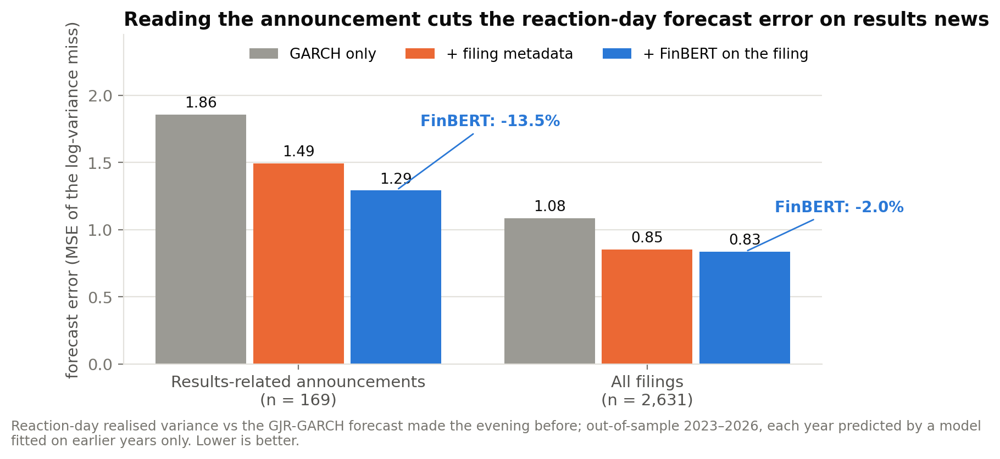
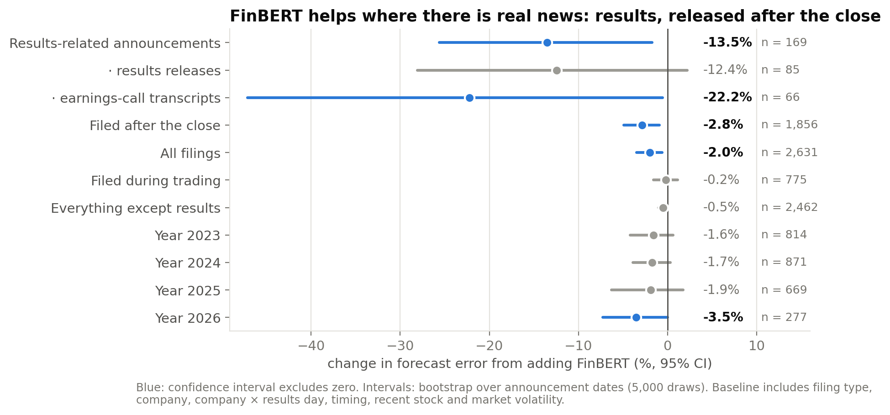
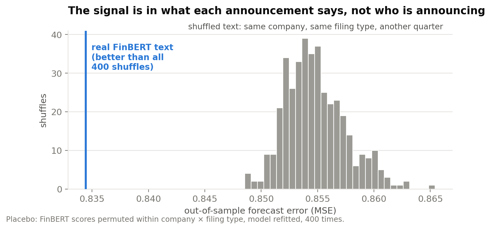
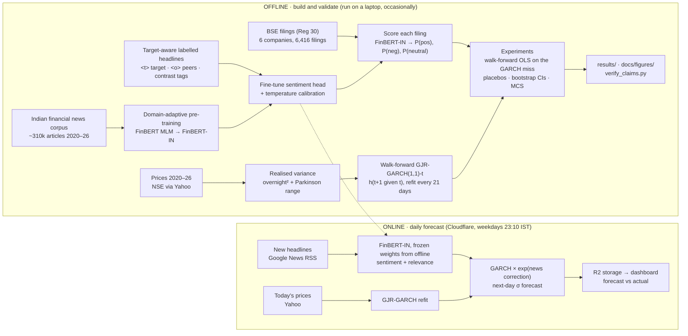

# FinBERT × GARCH — does reading the news improve volatility forecasts for Indian stocks?

A domain-adapted, target-aware **FinBERT** for Indian financial text, tested as an add-on to **GJR-GARCH** volatility
forecasts at two time scales: every trading day, and at the moment a company files an announcement with the BSE.

> **Main result.** Reading the company's own BSE announcement with FinBERT reduces the error of the reaction-day
> volatility forecast by **13.5 %** on results-related announcements (95 % CI −24.2 % to −1.8 %, n = 169,
> out-of-sample 2023–2026), over GARCH **plus** all filing metadata. The improvement disappears when the same
> company's text is swapped in from another quarter (0 of 400 placebo refits match it). On ordinary days, and for
> ordinary filings, sentiment adds nothing.
>
> Verify from the committed data in one command: `python experiments/verify_claims.py`  ·  write-up: [`docs/RESULTS.md`](docs/RESULTS.md)

---

## Results



| Reaction-day forecast error (MSE of ln RV − ln h), out of sample 2023–26 | n | GARCH | + metadata | + FinBERT | FinBERT effect (95 % CI) |
|---|---|---|---|---|---|
| **Results-related announcements** | 169 | 1.857 | 1.493 | **1.291** | **−13.5 %** [−24.2, −1.8] |
| · earnings-call transcripts | 66 | 1.095 | 1.321 | 1.028 | −22.2 % [−41.3, −0.7] |
| · results releases (Financial Results / Board outcome) | 85 | 2.641 | 1.704 | 1.492 | −12.4 % [−25.3, +2.7] |
| All filings | 2,631 | 1.083 | 0.851 | 0.834 | −2.0 % [−3.4, −0.6] |
| All filings except results-related | 2,462 | 1.030 | 0.807 | 0.803 | −0.5 % [−1.0, +0.0] |

Source rows: [`t1_subsets.csv`](results/experiments/event_reaction/t1_subsets.csv) ·
per-announcement data: [`t1_predictions.csv`](results/experiments/event_reaction/t1_predictions.csv) ·
full report: [`summary.md`](results/experiments/event_reaction/summary.md)

<table><tr>
<td></td>
<td></td>
</tr></table>

**Two experiments, one picture**

| | Daily (TCS, every trading day) | Announcement (6 companies, every BSE filing day) |
|---|---|---|
| Question | Does the day's news sentiment improve tomorrow's GARCH forecast? | Does the filing's text predict the volatility reaction to it? |
| Baseline to beat | GARCH + past volatility + article counts | GARCH + filing type, company, company × results, timing, recent volatility |
| FinBERT adds | **nothing** — +1.3 % vs article counts (p = 0.26); 78 % of placebos do as well | **−13.5 %** on results-related announcements; 0/400 placebos do as well |
| Report | [`finbert_vs_garch/summary.md`](results/experiments/finbert_vs_garch/summary.md) | [`event_reaction/summary.md`](results/experiments/event_reaction/summary.md) |

Text tells you **how big** the reaction to real news will be — not which way (tone vs return: ρ = 0.01), and not on
quiet days. This matches the finance literature (Loughran & McDonald 2011: tone predicts post-filing volatility far
better than returns).

The sentiment model itself: macro-F1 **0.757 → 0.839** vs off-the-shelf ProsusAI FinBERT (paired bootstrap, P(diff ≤ 0) = 0.001)
on target-aware Indian headlines — [`results/sentiment/summary.md`](results/sentiment/summary.md).
*Test labels are provisional (drafted, pending manual verification); the volatility results above do not depend on them.*

---

## Architecture



**Offline** is everything done once or occasionally to *build and validate*: pre-train and fine-tune the language
model, compute volatility targets, run the experiments. **Online** is the small daily loop that *uses* the frozen
model: fetch the day's headlines and prices, score, forecast, publish — [`cloudflare/`](cloudflare/README.md),
~$5/month.

How a single announcement becomes a forecast:

```
BSE filing (headline + summary, timestamped IST)
  → FinBERT-IN, target-aware input ("tcs" | "<t> TCS </t> Q2 net profit rises …")       → P(pos), P(neg), P(neutral)
  → features known at release time: filing type, company, after-close?, recent vol, market regime, FinBERT scores
  → walk-forward OLS predicts û = expected log gap between realised and GARCH variance on the reaction day
  → reaction-day variance forecast  = h_GARCH · exp(û + s²/2)
```

---

## Reproduce

```bash
git clone https://github.com/seshjuansauce/FinBERT-Indian-Stock-Market-Analysis.git && cd FinBERT-Indian-Stock-Market-Analysis
pip install -r requirements.txt
python experiments/verify_claims.py          # recompute the headline numbers from committed results (seconds, no data needed)
python experiments/figures.py                # redraw the figures
```
Full re-run (needs the news corpus, the BSE filings table and the trained model — see [`experiments/README.md`](experiments/README.md)):
```bash
python scripts/score_filings.py --axiom ../axiom                       # FinBERT-IN on every filing
python experiments/event_reaction.py --axiom ../axiom --placebo 400    # announcement-level experiment (~2 min)
python experiments/finbert_vs_garch.py --placebo 500 --boot 5000       # daily experiment
```
Docker: `docker compose build && docker compose run --rm finbert` runs the data → model → ladder pipeline
([`docs/PIPELINE.md`](docs/PIPELINE.md)).

## Repository map

| Path | What |
|---|---|
| `bert/` | domain-adaptive pre-training, sentiment fine-tuning (A/B/C ablation), calibration, labelling rubrics |
| `news/` | news download, entity analysis (target / peer / roundup roles), corpus scoring |
| `model/` | realised variance, walk-forward GARCH / GJR-GARCH, daily volatility ladder |
| `finbert_vol/` | class-based package: sentiment model wrapper, BSE + earnings-call scorers, features, volatility model, co-mention network, options-implied volatility (Black-76), live pipeline |
| `experiments/` | the two experiments, figures, `verify_claims.py` |
| `results/` | every reported number (CSV + markdown) |
| `cloudflare/` | online pipeline: Worker + container + R2 + dashboard |
| `docs/` | write-up, figures, detailed pipeline notes |

## Limitations

Six companies (3 IT, 3 pharma); 169 results-related announcement days out of sample — enough for the pooled claim,
not for each sub-type (results releases alone: −12.4 %, CI crosses zero). Text comes from the filing headline and a
~360-character summary, not the full document. Companies write their own filings, so FinBERT sees mostly neutral or
positive language (10 of 6,416 filings scored negative). FinBERT does not improve the probability of an abnormally large
(> 2σ) move beyond metadata. The sentiment classifier's test labels are provisional.
